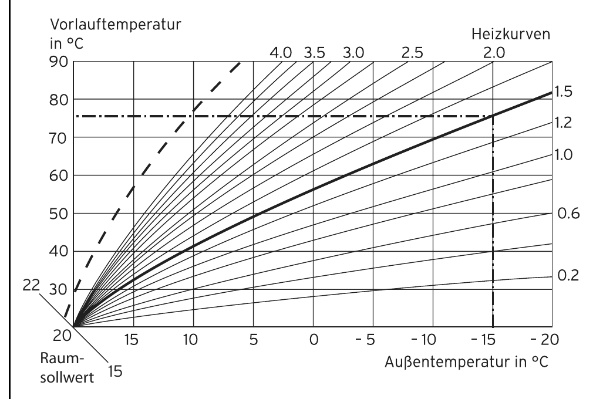

# Vaillant geoTHERM exclusiv VWS 83/2: heating curves

Covers the weather curve of this unit (diagram, table, formula, how closely the unit follows it);
indexed by `README.md` in this folder. Format and tags: `.claude/rules/devices.md`. Levers
(`mc/HeatingCurve`, `mc/TempDesired`, outdoor offset): `behaviour.md` `## Control`.

Diagram: BA p.21 (menu "HK2 Parameter"), the manual for VWS 63/2, 83/2 and 103/2; the owner's
printed copy shows the same diagram [BA p.21].

## How to read it

- Flow setpoint (Vorlauftemperatur) over outdoor temperature (Außentemperatur), one line per curve
  value, at room setpoint 20 °C; every curve starts at 20 °C flow at 20 °C outdoor [BA p.21].
- The room setpoint (`mc/TempDesired`) shifts the curve in parallel along the 45° axis (the
  15 / 20 / 22 scale at the origin) [BA p.18]: flow(T, RS) = flow₂₀(T − (RS − 20)) + (RS − 20),
  so +1 K setpoint raises the flow by 1 K plus the curve's slope at that point [BA p.18].
- Floor heating: curves < 0.4 [BA p.21]. Vaillant gives no formula [BA p.21].

## Formula

flow = RS + 2.55 · (curve · (RS − T_out))^0.78 (RS = room setpoint, all °C; the bracket counts as
0 when T_out ≥ RS) [KF]. Reverse-engineered for the current Vaillant sensoCOMFORT curves, written
there as T_flow − T_set = a·[curve × (T_set − T_out)]^b; it includes the 45° shift by
construction [KF]. Our comparison of the formula [KF] with the 83/2 diagram [BA p.21] (8 outdoor
points per curve): within ±0.7 K for 0.2, 0.4, 0.6, 0.8, 1.0 and 1.5; the line read as 1.2
deviates up to −1.7 K, label not re-checked. Not in any Vaillant document: the low columns below
rest on it [ASSUMED].

## Table (flow setpoint °C at room setpoint 20 °C)

Diagram columns read from the 83/2 diagram's vector paths in the PDF, not by eye (±0.2 K); check:
curve 1.5 at −15 °C gives 75.6, the manual's dash-dot example reads ≈ 76 [BA p.21]. Columns marked
¹ are the formula [KF]: the diagram has no curve below 0.2 [BA p.21].

| Outdoor | 0.13 ¹ | 0.14 ¹ | 0.15 ¹ | 0.2 | 0.4 | 0.6 | 0.8 | 1.0 | 1.2 | 1.5 |
|---|---|---|---|---|---|---|---|---|---|---|
| +20 °C | 20.0 | 20.0 | 20.0 | 20.0 | 20.0 | 20.0 | 20.0 | 20.0 | 20.0 | 20.0 |
| +15 °C | 21.8 | 21.9 | 22.0 | 22.5 | 24.3 | 25.6 | 27.6 | 29.2 | 30.7 | 32.3 |
| +10 °C | 23.1 | 23.3 | 23.5 | 24.5 | 27.6 | 30.0 | 33.3 | 35.9 | 38.7 | 41.2 |
| +5 °C | 24.3 | 24.5 | 24.8 | 26.3 | 30.4 | 33.8 | 38.3 | 41.7 | 45.6 | 49.0 |
| 0 °C | 25.4 | 25.7 | 26.0 | 28.0 | 33.0 | 37.4 | 42.8 | 46.8 | 51.9 | 56.1 |
| −5 °C | 26.4 | 26.8 | 27.1 | 29.5 | 35.5 | 40.9 | 47.0 | 51.7 | 57.7 | 62.9 |
| −10 °C | 27.4 | 27.8 | 28.2 | 31.0 | 37.7 | 44.1 | 51.1 | 56.3 | 63.3 | 69.4 |
| −15 °C | 28.3 | 28.8 | 29.3 | 32.2 | 39.9 | 47.2 | 55.0 | 60.8 | 68.6 | 75.6 |
| −20 °C | 29.2 | 29.8 | 30.3 | 33.2 | 41.9 | 50.0 | 58.9 | 65.4 | 73.9 | 81.8 |

¹ Formula, not manufacturer values [KF]. Do not interpolate between 0.1 and 0.2 instead: the /3
manual draws a 0.1 curve [IA3 p.66]; compared with the formula [KF] it lies 2–2.5 K above, while
its 0.2–1.0 curves match the 83/2 diagram [BA p.21], so interpolating from it would overstate
0.13–0.15 by ≈ 1.5 K (our comparison).

The flow setpoint is capped by `FlowTempMax` whatever the curve (`protections.md` VWS-8).

## How closely this unit follows it

- **VWS-30** The unit's setpoint jumps where the table is smooth: at 0.14 / `TempDesired` 22.5 one
  edge at ≈ −2.5 °C (unit's outdoor value) was seen, crossed once each way, 27.5 ↔ 29.5 with no
  hysteresis, flat on both sides (27.5 from +1.06 to −2.38 °C where the formula goes
  28.5 → 29.2; 29.5 from −2.62 to −4.25 °C, formula 29.3 → 29.6) [T21]; at 0.13 / 22 the
  setpoint jumped 24 ↔ 26, never 25 [T23]. Whether the whole curve is stepped (2 K), and its
  edges elsewhere: `behaviour.md` Open questions.
- The unit's whole-degree setpoint runs 0–2 K below the formula, mostly 0.5–1.5 K: 0.15 / 22
  within −1.4 … +0.1 K; 0.13 / 22 and 0.14 / 22.5 0.8–2.1 K below; 0.13 / 22 ≈ 2 K below at 8 °C,
  more than whole-degree readings explain [T24]. Measured on `mc/Status0a` field 4 (= floor of
  `mc/FlowTempDesired`, up to 1 K below it, like `uih/FlowTempDesired` [T25]) against the house
  weatherstation (±1 K, night and evening hours), which reads warmer than the unit's outdoor
  sensor (`behaviour.md` VWS-31).
- Every fine setpoint seen so far (2026-11-21…22) is `TempDesired` + a whole number [T20].
