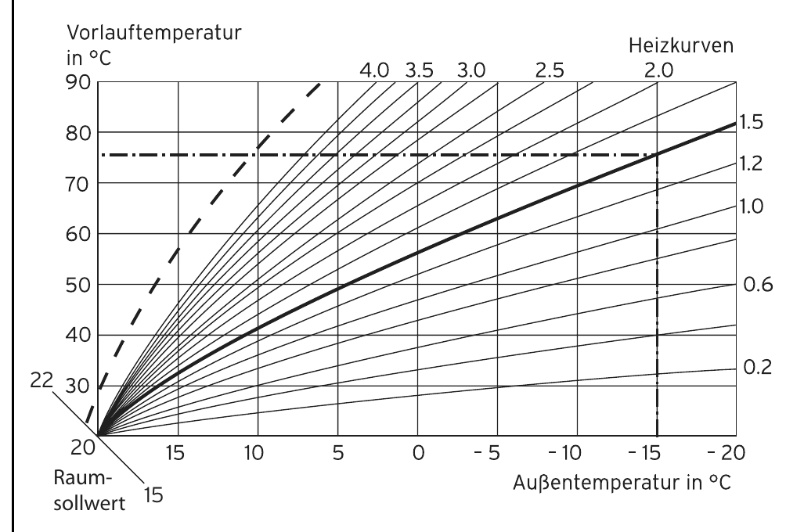

# heating_pv_boost: geoTHERM VWS 83/2 heating curves

Reference for tuning `mc/HeatingCurve` and `mc/TempDesired` (`sensor.geotherm_heating_curve`,
`number.geotherm_heating_temp_desired`); not auto-loaded, read when reasoning about the flow
setpoint. Package facts and rules: `doc/heating_pv_boost/notes.md`.

Source: Vaillant *Bedienungsanleitung geoTHERM exclusiv VWS* (DE/AT/CH), 0020025604_00, 02/2007,
which covers VWS 63/2, **83/2** (art. 0010002787, this unit) and 103/2. Diagram p. 21 (menu "HK2
Parameter"); the owner's printed manual shows the same diagram. Download:
https://kontakt.vaillant.de/documents/download/73792/

## How to read it

- Flow setpoint (Vorlauftemperatur) over the outdoor temperature (Außentemperatur), one line per
  curve value, at room setpoint 20 °C. Every curve starts at 20 °C flow at 20 °C outdoor.
- Room setpoint (`mc/TempDesired`) shifts the curve in parallel along the 45° axis (the 15 / 20 /
  22 scale at the origin; manual p. 18): flow(T, RS) = flow₂₀(T − (RS − 20)) + (RS − 20). So a
  setpoint step of +1 K raises the flow by 1 K plus the curve's slope at that point.
- Floor heating: curves < 0.4 (manual p. 21). No formula is given anywhere: the table is read off
  the diagram.

## Table (flow setpoint °C at room setpoint 20 °C)

Read from the diagram's vector paths in the PDF, not by eye (±0.2 K). Check: curve 1.5 at
−15 °C gives 75.6, the manual's dash-dot example reads ≈ 76.

| Outdoor | 0.1 ¹ | 0.13 ² | 0.14 ² | 0.15 ² | 0.2 | 0.4 | 0.6 | 0.8 | 1.0 | 1.2 | 1.5 |
|---|---|---|---|---|---|---|---|---|---|---|---|
| +20 °C | 20.0 | 20.0 | 20.0 | 20.0 | 20.0 | 20.0 | 20.0 | 20.0 | 20.0 | 20.0 | 20.0 |
| +15 °C | 22.4 | 22.4 | 22.4 | 22.4 | 22.5 | 24.3 | 25.6 | 27.6 | 29.2 | 30.7 | 32.3 |
| +10 °C | 24.1 | 24.2 | 24.3 | 24.3 | 24.5 | 27.6 | 30.0 | 33.3 | 35.9 | 38.7 | 41.2 |
| +5 °C | 25.5 | 25.7 | 25.8 | 25.9 | 26.3 | 30.4 | 33.8 | 38.3 | 41.7 | 45.6 | 49.0 |
| 0 °C | 26.7 | 27.1 | 27.2 | 27.3 | 28.0 | 33.0 | 37.4 | 42.8 | 46.8 | 51.9 | 56.1 |
| −5 °C | 27.7 | 28.3 | 28.4 | 28.6 | 29.5 | 35.5 | 40.9 | 47.0 | 51.7 | 57.7 | 62.9 |
| −10 °C | 28.6 | 29.3 | 29.5 | 29.8 | 31.0 | 37.7 | 44.1 | 51.1 | 56.3 | 63.3 | 69.4 |
| −15 °C | 29.3 | 30.2 | 30.5 | 30.8 | 32.2 | 39.9 | 47.2 | 55.0 | 60.8 | 68.6 | 75.6 |
| −20 °C | 29.7 | 30.7 | 31.1 | 31.4 | 33.2 | 41.9 | 50.0 | 58.9 | 65.4 | 73.9 | 81.8 |

¹ Not in the 83/2 manual (its lowest curve is 0.2). Taken from the successor's installation
manual (*Installationsanleitung geoTHERM exclusiv*, 0020087974_00, 04/2010, valid for VWS
63/3–103/3 only, p. 66), whose 0.2–1.0 curves match the 83/2 diagram to 0.1 K. UNPROVEN that the
/2 controller uses the same 0.1 curve.
² Linear interpolation between 0.1 and 0.2: NOT manufacturer values.

`mc/FlowTempMax` (35 °C) caps the setpoint whatever the curve (note "Compressor and measurements").

Outdoor sensor calibration (installer menu A8 "Kalibrierung" → "Aussentemperatur", ±5 K in 1 K
steps; *Installationsanleitung* 0020087974_00 p. 82; ebusd `ehp/OutsideTempOffset`): 0 K (owner,
2026-11-21). The manual calls it an adjustment of the displayed temperature; that the curve uses
the corrected value, i.e. that it shifts the curve sideways (+1 K = read warmer = lower flow), is
UNPROVEN. It would also move every other outdoor threshold (frost protection, summer cut-off,
cooling release).

## Open: the machine does not follow this table

OBSERVED (Nov 2026): the flow setpoint (`mc/Status0a` field 4) runs 1.5–3.5 K below the table
(room setpoint applied), and 0.13 vs 0.15 differ by ≈ 2 K instead of ≈ 0.2–0.4 K. Measured against
the weatherstation, not yet against the machine's own outdoor value
(`sensor.geotherm_heating_outdoor_temp`). Investigation and hypotheses:
`plans/heating-curve-tuning.md` (A.3, step 0.5).
