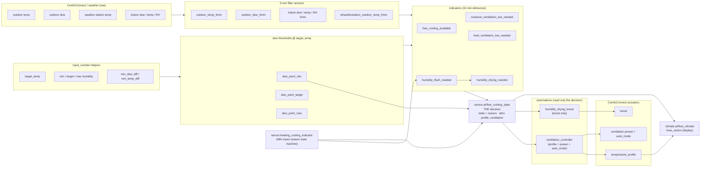
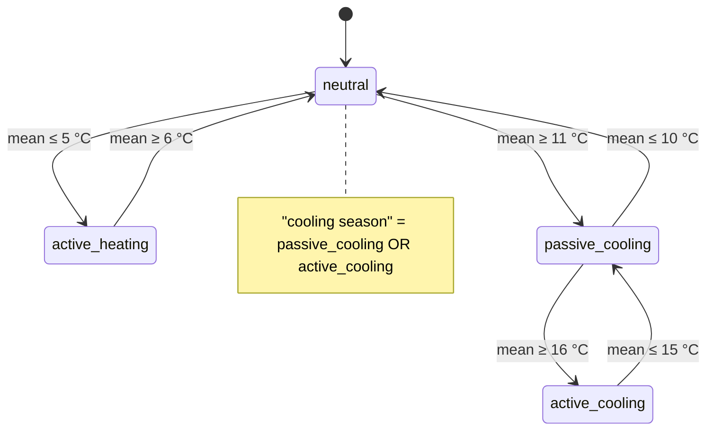
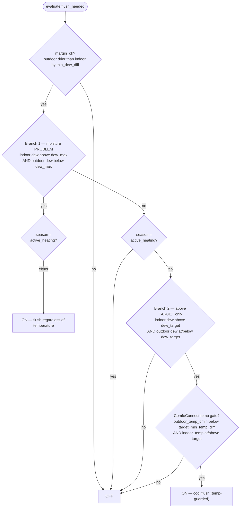
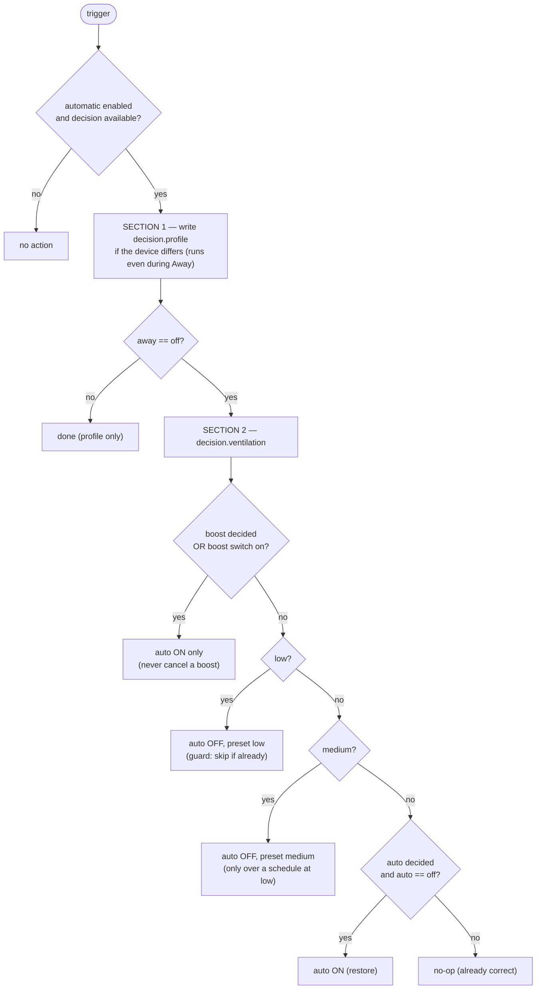

# Airflow Cooling & Humidity — Architecture Design

**Scope:** `packages/airflow_cooling.yaml` (+ `packages/heating_cooling_indicator.yaml`)
**Hardware:** Zehnder ComfoAir Q350 ERV via the ComfoConnect integration
**Status:** Living document — reflects the dew-point + dew-difference-flush design.

> Related plans: [ventilation-profile-automation.md](ventilation-profile-automation.md),
> [airflow-threshold-inputs-humidity-fallback.md](airflow-threshold-inputs-humidity-fallback.md),
> [airflow-bypass-sensor.md](airflow-bypass-sensor.md).

---

## 1. Purpose

Drive the ERV's **temperature profile** (`warm` / `comfort` / `cool`) and **ventilation level**
(auto / low / medium / boost) automatically, to:

1. **Free-cool** the house when outdoor air is cool and dry enough (open the bypass).
2. **Flush indoor moisture** when indoor air is too humid and outdoor air is drier — even when
   the target humidity can't be reached (mould / condensation safety).
3. **Protect** against importing humid outdoor air (reduce ventilation).
4. **Retain moisture** in dry winter air (keep the heat exchanger recovering).

Every humidity decision is expressed in **dew point** (absolute moisture) rather than relative
humidity, because RH thresholds drift as indoor temperature changes. All dew thresholds are
computed at the **target temperature** via the Magnus formula.

---

## 2. Entity inventory

### Inputs — filter sensors (5-min time-weighted average, throttled)

| Entity | Source | Meaning |
|---|---|---|
| `sensor.airflow_min_indoor_dew_5min` | indoor dew aggregate | **indoor moisture** |
| `sensor.airflow_avg_indoor_temp_5min` | indoor temp aggregate | indoor temperature |
| `sensor.airflow_avg_indoor_humidity_5min` | indoor RH aggregate | indoor RH (display) |
| `sensor.airflow_outdoor_dew_5min` | ComfoConnect intake | **outdoor moisture** |
| `sensor.airflow_outdoor_temp_5min` | ComfoConnect intake | **ComfoConnect outdoor temp** |
| `sensor.airflow_wheatherstation_outdoor_temp_5min` | weather station (filtered) | **real outdoor temp, smoothed** |
| supply/extract air temp+humidity | ComfoConnect | bypass estimation |

> **Two outdoor temperatures — and why they differ.** The ComfoConnect intake draws through a long
> **underground duct**, so its temperature is governed by the surrounding earth, not the outside
> air. The ground changes far more slowly than outdoor temperature and only drifts across the year:
> it stays cool through summer and relatively warm through winter. The intake air is therefore
> **pre-cooled on summer days and pre-warmed on winter days**, and the intake reading
> (`airflow_outdoor_temp_5min`) lags and is far more stable than the real outdoor temperature
> (`airflow_wheatherstation_outdoor_temp_5min`, the weather station).
>
> The ground's cooling capacity is a **finite reservoir**. The intake temperature tells us *what is
> being delivered*; the real outdoor temperature tells us *the thermal load we place on the ground*.
> If we raised airflow based on the (cool) intake reading, we would pull a larger volume of hot
> outdoor air through the duct, warming the earth faster and using up its cooling capacity — negating
> the benefit. So the split is deliberate:
> - the **cool profile / delivery** follows the **intake** temp (`free_cooling_available`,
>   `humidity_flush_needed` temp gate) — it is the air actually delivered;
> - any decision that **raises or holds down flow** is guarded by the **real outdoor** temp: the
>   *boost* (`humidity_drying_needed`) and the *heat-protect* low guard (`heat_ventilation_low_needed`).
>
> Smoothing on the weather-station chain replaces the boost sensor's old `delay_on` debounce — noise
> spikes can no longer falsely start/stop a boost.

### Derived thresholds — dew point at target temp (Magnus)

| Entity | From helper | Used as |
|---|---|---|
| `sensor.airflow_dew_point_min` | `airflow_min_humidity` | dry-air floor (moisture retention) |
| `sensor.airflow_dew_point_target` | `airflow_target_humidity` | comfort target / free-cooling ceiling |
| `sensor.airflow_dew_point_max` | `airflow_max_humidity` | moisture-problem ceiling |

### Decision binary sensors

| Entity | Fires when | Debounce |
|---|---|---|
| `binary_sensor.airflow_free_cooling_available` | outdoor cool **and** dry enough to free-cool | `delay_on`/`delay_off` 10 min |
| `binary_sensor.airflow_humidity_flush_needed` | indoor too humid **and** outdoor drier (cool-profile flush) | `delay_on`/`delay_off` 10 min |
| `binary_sensor.airflow_moisture_ventilation_low_needed` | outdoor too humid to import | `delay_on`/`delay_off` 10 min |
| `binary_sensor.airflow_heat_ventilation_low_needed` | **real outdoor** too warm to import (≥ indoor) | `delay_on`/`delay_off` 10 min |
| `binary_sensor.airflow_ventilation_low_needed` | combined low intent — moisture **or** heat | none (OR of debounced sources) |
| `binary_sensor.airflow_humidity_drying_needed` | flush **and** weather-gated (smoothed) **and** scheduled (boost) | `delay_off` 10 min only |

> **`drying_needed` has no `delay_on`.** Its temp input is now the smoothed
> `airflow_wheatherstation_outdoor_temp_5min`, so the 5-min filter absorbs noise that `delay_on`
> used to guard against. Dropping `delay_on` cuts boost start latency by 10 min (was flush 10 +
> drying 10 = 20 min; now ~10 min). `delay_off` kept to avoid premature boost stop.

### Actuators (ComfoConnect)

`select.comfoconnect_pro_temperature_profile` (warm/comfort/cool) ·
`switch.comfoconnect_pro_boost` + `number.comfoconnect_pro_boost_time` ·
`select.comfoconnect_pro_ventilation_preset` (low/medium) + `switch.comfoconnect_pro_auto_mode`.

### Read-only views

`climate.airflow_climate` (hvac_mode + hvac_action) · `sensor.airflow_bypass_estimation`.
`sensor.airflow_cooling_state` is **not** a view: it is the single decision (§6).

---

## 3. Data flow

Indicators feed **one** decision sensor; every automation that changes the device reads only that
decision. The decision never reads the outputs, so applying it cannot change it.



---

## 4. Season state machine — `sensor.heating_cooling_indicator`

A Schmitt-trigger state machine over the **48-hour mean** outdoor temperature
(`sensor.wheatherstation_outdoor_temperature_48h_mean`). Wide hysteresis bands prevent the
season from flapping day-to-day. This is the **season context** consumed by the profile logic.



---

## 5. Decision sensors

### 5.1 `free_cooling_available` — temperature free cooling

All four must hold (indoor-temp uses a 0.5 °C Schmitt: ON at `target`, stays on to `target − 0.5`):

```
(outdoor_dew + min_dew_diff) < indoor_dew        # outdoor drier by a margin
AND outdoor_dew ≤ dew_point_target               # importing it won't exceed target humidity
AND outdoor_temp_5min < indoor_temp − temp_diff  # intake cooler than the ROOM (not just target)
AND indoor_temp ≥ temp_threshold                 # room warm enough to want cooling
```

The temp gate is **indoor-relative**: any outdoor air `min_temp_diff` below the *current room*
temperature can free-cool it — a 26 °C room is cooled by 22 °C air even though 22 °C is above a
21.5 °C target. `indoor_temp ≥ temp_threshold` still halts cooling at target, and the room can
never be driven below outdoor temperature. `temp_diff` carries a 0.5 °C release band (`min_temp_diff
− 0.5`, clamped at 0, while ON) to damp flip-flop as the room converges on the outdoor temperature.

### 5.2 `humidity_flush_needed` — cool-profile moisture flush

Two OR branches, both requiring a real outdoor→indoor moisture **difference**
(`margin_ok = outdoor_dew + min_dew_diff − h < indoor_dew`). A `0.3 °C` `this.state` hysteresis
(`h`) relaxes every boundary while ON.



Key asymmetry:
- **Branch 1** (indoor above max = a real problem) → flushes **regardless of temperature**.
- **Branch 2** (above target only) → flushes **only if** the ComfoConnect temp gate holds, so a
  non-urgent flush never overcools a cool room.
- In **active_heating**, only Branch 1 is allowed.

### 5.3 `moisture_ventilation_low_needed` — humid-import protection

Indoor Schmitt (`indoor_dew ≥ dew_max` ON, stays on to `dew_target`) AND
(`outdoor_dew ≥ dew_threshold` OR `outdoor_dew ≥ indoor_dew`). Broadly the inverse of free
cooling: outdoor air is too humid to bring in.

### 5.3b `heat_ventilation_low_needed` — hot-import protection

The **temperature symmetric** of §5.3: the direct analog of that sensor's `outdoor_dew ≥ indoor_dew`
term is `outdoor_temp ≥ indoor_temp`, on the **real outdoor** (weather-station) temp. Schmitt:
turns ON when real outdoor reaches indoor, stays ON until it falls `min_temp_diff` below indoor.
Gated OFF while a flush or the drying boost runs (mirrors §5.3). Forces LOW when outdoor air is too
warm to import at volume — importing it adds net heat *and* saturates the underground duct's cooling
reservoir (see §2). Because hot outdoor air is usually also humid, this and §5.3 frequently coincide;
heat protection additionally covers hot-but-dry spells the dew-point guard misses.

**Design intent (not just a consequence).** A hot day with acceptable indoor humidity is **always**
held at LOW — that is the goal, not a side effect. The single sanctioned override is a genuine
indoor-moisture problem: a flush requires indoor dew above the **target** humidity (Branch 2) or
above **max** (Branch 1) *and* outdoor drier than indoor, so it can override heat protection only
when indoor is actually too moist — and only at **MEDIUM** (mould/condensation safety outranks
sparing the reservoir). A boost (HIGH) can never coincide with heat, since `drying_needed` requires
weather-station `< target`. So: comfortable indoor humidity + hot outside ⇒ **LOW**; too-moist
indoor + hot-but-dry outside ⇒ a medium flush is allowed.

### 5.3c `ventilation_low_needed` — combined low intent

`moisture_ventilation_low_needed` **OR** `heat_ventilation_low_needed`. Display/history only — the
decision (§6) reads the two guards separately to label heat vs moisture protection. Pure OR of two
already-debounced sources — no extra debounce.

> **State-based, not trigger-based (deliberate).** Because it derives from two *slow* binary sensors
> that can sit steady for hours, a trigger-based version would restore its last state on HA restart
> and only recompute on an input *change* — so it could come back **stale** (`off` while `heat_low`
> is `on`) and never recompute, stranding its consumer off the low intent (observed: `heat_protection`
> all day yet preset stuck at medium). A plain state template re-evaluates continuously and at
> startup, so it can't go stale.

### 5.4 `humidity_drying_needed` — the noisy boost

```
flush_needed
AND NOT low_active
AND airflow_wheatherstation_outdoor_temp_5min < target_temp  # smoothed REAL outdoor, not intake
AND in_schedule                                              # workday / non-workday window
```

The cool-profile flush deliberately **ignores** the schedule and weather station; only the boost
is schedule- and weather-gated. The temp input is the **smoothed** weather-station sensor
(`| float(99)` fail-safe kept: unavailable → 99 °C → gate fails → no boost). `delay_on` removed;
`delay_off` 10 min kept (see §2 decision-sensor note).

---

## 6. The decision — `sensor.airflow_cooling_state`

A **state-based** template sensor (it derives from slow binary indicators, so it must never
restore stale — §10). Its state and its `profile` / `ventilation` attributes all render from one
Jinja macro, `custom_templates/airflow_decision.jinja`, so the reason shown on the dashboard and the
outputs applied can never disagree. Inputs: `automatic_enabled`, the season, `free_cooling_available`,
`humidity_flush_needed`, `humidity_drying_needed`, `moisture_ventilation_low_needed`,
`heat_ventilation_low_needed`, indoor dew vs `dew_point_min`. **Never** the profile, preset, boost
switch or climate. Unavailable unless every indicator holds a value (the automations then no-op).

**Profile** (protections never change it — they only lower the rate), first match wins:

| # | Condition | profile |
|---|---|---|
| P1 | `flush_needed` (⊇ `drying_needed`) | cool — moisture relief in any season |
| P2 | season = `active_heating` | warm — free cooling is never used in heating season |
| P3 | indoor dew < `dew_point_min` − 0.1 (stay while < `dew_point_min`) and season not cooling | warm — retain moisture (beats free cooling) |
| P4 | `free_cooling_available` | cool |
| P5 | otherwise | comfort |

No row keeps the current profile, so there is no stuck-`cool` / stuck-`warm` trap to recover from
(the former Blocks 3/4/5 collapse into P5). P3's hysteresis memory is the sensor's previous
`profile` attribute.

**Ventilation**, first match wins: `drying` → **boost** · `flush` → **medium** · moisture-low or
heat-low → **low** · profile chosen by P4 (free cooling) → **medium** · otherwise **auto**.

**State (reason)**, first match wins: `off` (automation disabled; profile/ventilation `off`) ·
`moisture_flush_boost` · `moisture_flush_cooling` · `heat_protection` (heat-low, not moist) ·
`moisture_protection` · `free_cooling` (P4) · `moisture_retention` (warm and dry) · `heating` (warm) ·
`comfort`.

| Example | state | profile | ventilation |
|---|---|---|---|
| active_heating + free cooling available (2026-10-23) | heating | warm | auto |
| neutral/cooling + free cooling | free_cooling | cool | medium |
| hot real outdoor + free cooling (cool intake) | heat_protection | cool | low |
| humid outdoor in active_heating | moisture_protection | warm | low |
| heating-season flush (indoor above max) | moisture_flush_cooling | cool | medium |
| flush + drying (schedule, cool weather station) | moisture_flush_boost | cool | boost |
| dry indoor, neutral, free cooling available | moisture_retention | warm | auto |
| dry indoor, cooling season | comfort | comfort | auto |
| humid indoor, no flush possible, neutral | comfort | comfort | auto |

> Every input is a 10-min-debounced sensor (or a wide-hysteresis season state), so the decision
> cannot change more than roughly every 10 minutes.

---

## 7. Actuator automations

Two automations drive the actuators. The **controller** owns profile + preset + auto_mode
deterministically; **boost** is isolated with its own hardware-timer mechanics.

### 7.1 `airflow_ventilation_controller` (mode: queued)

Applies the decision **idempotently** — no two automations fight over preset/auto_mode. `queued`
(not restart) so a rapid second trigger never aborts a partial auto-off→preset apply. Triggers: the
decision (state or attribute change), the device reporting a profile on its own (reconnect /
manual change), auto_mode→on, preset→low, boost→off, Away→off, HA start.

Gated at automation level by `automatic_enabled == on` and a decision with a value. Away handled
**inside**: profile runs always, preset/auto_mode only when `away == off`.



Service order in low/medium: **auto_mode off first, then preset** (schedule can't override the
manual preset mid-apply).

#### Airflow-increase guard invariants (load-bearing)

Raising the ventilation **rate** — the medium bump, or the high boost — is what pulls outdoor air
into the house in volume, so every increase is guarded. Opening the cool **profile** (bypass) is a
separate thing: it changes the air *path*, not the fan level.

1. **Dry-air only — no increase ever imports humid air.** Both rate-increase triggers require
   outdoor distinctly drier than indoor: `free_cooling_available` and `flush_needed` each demand
   `outdoor_dew + min_dew_diff < indoor_dew` (free cooling additionally caps `outdoor_dew ≤
   dew_target`). Medium via free *or* flush, and the boost (⊂ flush), all inherit this.

2. **A cooling increase is guarded on moisture AND real outdoor temperature.** The only
   temperature-driven increase is the medium bump for free cooling (decision P4, flush off, never in
   active heating). It is decided only when both low guards are **off** — i.e. `heat_low` off, meaning the **real outdoor**
   (weather-station) temp is below indoor. So a hot real-outdoor day (≥ indoor) can never raise flow
   for cooling; `heat_low` forces LOW instead, overriding even a schedule-set medium/high. The boost
   is likewise real-outdoor-guarded (`drying_needed` requires weather-station `< target`).

3. **The cool profile is guarded on the *intake* temperature, not the rate.** Decision P4 opens `cool`
   on `free_cooling_available`, whose temp gate is the pre-cooled ComfoConnect **intake**
   (`outdoor_temp_5min < indoor − min_temp_diff`); P1 opens `cool` to flush moisture. Opening
   the bypass never changes the fan level — that stays governed by invariants 1–2. This is exactly
   why a hot day can sit at **bypass-open + LOW**: cool delivery through the pre-cooled duct at the
   minimum rate.

**The one hot-weather increase is a moisture flush, by design.** When `flush_needed` is on (indoor
above target humidity, outdoor drier) the decision ranks it above both low guards, so medium is
decided even if real outdoor ≥ indoor. That is a **moisture** relief
action — dry air, at **medium** never high (the boost's weather-station `< target` gate keeps it off
in heat) — and mould/condensation safety is the one thing allowed to raise flow on a hot day. It is
**not** a cooling increase escaping the temperature guard.

### 7.2 `airflow_humidity_drying_boost` (mode: queued)

Starts a 60-min boost when the decision's `ventilation` becomes `boost`, re-arms it seamlessly
(re-sends boost ON at countdown < 5 min) while boost is still decided, and stops it when the
decision leaves boost for a real non-boost level (an unavailable decision never stops a boost).
Gated `automatic_enabled == on` + `away == off`. Boost never touches profile/preset/auto_mode;
the controller never touches boost.

---

## 8. `hvac_action` (climate display)

`climate.airflow_climate`'s `hvac_action` shows what the **device** does: `drying` when the decision
is a flush (`moisture_flush_boost` / `moisture_flush_cooling`) **and** the profile is `cool`;
otherwise `cooling` / `heating` / `fan` for the actual cool / warm / comfort profile. It reads the
decision, never the raw boost switch, so the switch's few-second drop on each boost re-arm cannot
flip it.

---

## 9. Tunable parameters

| Helper | Role |
|---|---|
| `airflow_cooling_target_temperature` | reference temp for all dew thresholds & temp gates |
| `airflow_target_humidity` | comfort dew target / free-cooling ceiling |
| `airflow_min_humidity` / `airflow_max_humidity` | dry-air floor / moisture-problem ceiling |
| `airflow_min_dew_diff` | required outdoor→indoor dew margin |
| `airflow_min_temp_diff` | required outdoor→target temp margin |
| `airflow_bypass_efficiency_max/min` | bypass-estimation calibration |
| `schedule.airflow_boost_workday` / `_non_workday` | boost time windows |

---

## 10. Anti-flip-flop mechanisms (summary)

| Mechanism | Where | Effect |
|---|---|---|
| 10-min `delay_on`/`delay_off` | free/flush/low sensors (`drying`: `delay_off` only) | caps decision rate at ~10 min |
| 5-min filter on weather temp | `wheatherstation_outdoor_temp_5min` | replaces boost `delay_on`; absorbs noise spikes |
| idempotent unified controller | preset + auto_mode | single owner, no cross-automation hand-off race |
| 0.3 °C dew hysteresis (`this.state`) | flush sensor branches | damps the flush feedback loop |
| 0.5 °C indoor-temp Schmitt | free cooling + flush temp gate | cooling can't disable its own trigger |
| dew Schmitt (target↔max) | low-vent sensor | stable humid-import boundary |
| 0.1 °C dry-retention hysteresis | decision P3 (memory = previous profile) | anti-chatter at the dew_min edge |
| wide-band 48h-mean state machine | season indicator | season changes over days, not hours |
| idempotent apply | controller | no redundant profile / preset writes |
| stateless decision | `sensor.airflow_cooling_state` | every reason maps to one profile — no stuck-profile traps |

> **Trigger-based vs state-based (restart-stale guardrail).** The decision sensors are
> *trigger-based* and restore on restart to preserve the delay + Schmitt hysteresis; each is driven
> by a continuously-drifting numeric filter (outdoor temp/dew, weather-station temp), so it recomputes
> within ~1 debounce after a restart. `ventilation_low_needed` and `airflow_cooling_state` are
> **state-based on purpose**: it derives from only two *slow binary* sensors (`moisture_low`, `heat_low`),
> so trigger-based + restore could leave them stale for hours (it did — `off` while `heat_low` was on
> all day). Rule: a template binary_sensor whose inputs are only other binary sensors must be
> state-based. See `packages/CLAUDE.md`.

---

## 11. Complete state transition reference

The full input → output mapping is the decision table in §6 (source:
`custom_templates/airflow_decision.jinja`), plus the controller guards in §7.1: Away skips the
preset/auto_mode half, a running boost is never cancelled, and every write is idempotent. The
decision-table tests in `tests/test_airflow.py` (`test_decision_*`) pin each row.

The previous per-block matrix (Blocks 1–5, `keep` traps C7/N3/C8/W1/W2/H6) is obsolete: the
decision is stateless apart from P3's dry-retention hysteresis, so there is no `keep` row left.
History: `plans/airflow-cooling-state-single-decision.md`.
